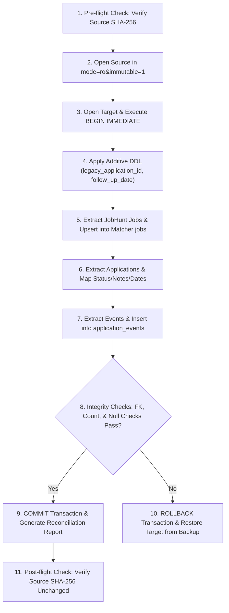

# Stage C.3 — Application Data Migration and Rollback Plan

**Date:** 2026-10-19  
**Role:** Backend / Data Auditor for JobHunt + Resume Matcher Integration  
**Mode:** Architectural Plan and Specification. No execution permitted during this audit.

---

## 1. Migration Architecture and Safety Envelope

This plan defines the end-to-end execution, validation, and rollback protocols for migrating JobHunt application tracking records and event history into Resume Matcher.

### 1.1 Non-Negotiable Operational Principles
1. **Disposable Copies Only:** Never execute migration code against live production databases. All dry-runs and validation runs execute between a disposable read-only snapshot source and an isolated target database copy.
2. **Read-Only Source Enforcement:** Source SQLite connections must open strictly with `file:...sqlite?mode=ro&immutable=1` and execute `PRAGMA query_only=ON;`.
3. **Atomic Execution:** The migration is wrapped in a single explicit database transaction (`BEGIN IMMEDIATE`). Any unexpected failure, unhandled conflict, or data validation error triggers an immediate `ROLLBACK`.
4. **Deterministic Idempotency:** The migration must be strictly idempotent. Re-running the migration against a previously migrated target database must detect existing records via `legacy_application_id` and exit cleanly without creating duplicates or altering ordering.
5. **Zero Mutation of Authoritative Source:** The original JobHunt database (`app/data/jobhunt.db`) and the disposable pilot snapshot (`jobhunt_snapshot.sqlite`) must have identical cryptographic SHA-256 hashes before and after migration.

---

## 2. Source and Target Environment Configuration

### 2.1 Workspace and File Paths
- **Source Snapshot (Read-Only):**
  `D:\AI-Job\stage-c-pilot\jobhunt_snapshot.sqlite`
- **Source Live DB (Untouched):**
  `D:\AI-Job\ai-job-search\app\data\jobhunt.db`
- **Target Staging Database (Isolated):**
  `D:\AI-Job\stage-c-pilot\matcher-data\resume_matcher_staging.sqlite`
- **Migration Script Location (Planned):**
  `D:\AI-Job\ai-job-search-integration\scripts\migrate_jobhunt_applications.py`
- **Reconciliation Audit Log:**
  `D:\AI-Job\stage-c-pilot\migration_reconciliation_report.json`

### 2.2 Pre-Migration Backup and Hashing Protocol
Before initiating migration execution:
1. Halt any running local backend or worker processes (prevent concurrent WAL writes).
2. Record the pre-migration SHA-256 digest of both source files using PowerShell `Get-FileHash`:
   ```powershell
   Get-FileHash -Algorithm SHA256 "D:\AI-Job\stage-c-pilot\jobhunt_snapshot.sqlite"
   Get-FileHash -Algorithm SHA256 "D:\AI-Job\ai-job-search\app\data\jobhunt.db"
   ```
3. Create an isolated working copy of the Resume Matcher target database:
   ```powershell
   Copy-Item "D:\Resume-Matcher\Resume-Matcher\data\resume_matcher.sqlite" "D:\AI-Job\stage-c-pilot\matcher-data\resume_matcher_staging.sqlite"
   ```
4. Record the target baseline SHA-256 digest.

---

## 3. Step-by-Step Migration Execution Protocol



### Step 1: Pre-flight Verification
- Connect to the source snapshot and verify schema integrity:
  `PRAGMA integrity_check;` $\to$ must return `ok`.
- Validate that table counts match expectations:
  - `jobs`: 244
  - `applications`: 2
  - `events`: 6

### Step 2: Additive Target Schema Migration
Execute additive DDL against the target database to accommodate JobHunt tracking metadata without disturbing existing Resume Matcher functionality:

```sql
-- 1. Ensure resume_id in applications can be NULL for imported leads
-- (In SQLite, accomplished by table recreation if strict NOT NULL was defined,
-- or by updating SQLAlchemy model definition before init_models_sync)

-- 2. Add additive columns to applications
ALTER TABLE applications ADD COLUMN legacy_application_id VARCHAR(256);
ALTER TABLE applications ADD COLUMN legacy_status VARCHAR(32);
ALTER TABLE applications ADD COLUMN follow_up_date VARCHAR(10);

-- 3. Create index on legacy_application_id for fast idempotent deduplication
CREATE UNIQUE INDEX IF NOT EXISTS uq_applications_legacy_id ON applications(legacy_application_id);

-- 4. Create additive application_events table for status history
CREATE TABLE IF NOT EXISTS application_events (
  event_id VARCHAR(36) PRIMARY KEY,
  application_id VARCHAR(36) NOT NULL REFERENCES applications(application_id) ON DELETE CASCADE,
  legacy_event_id INTEGER,
  kind VARCHAR(32) NOT NULL,
  detail TEXT,
  occurred_at VARCHAR(32) NOT NULL
);
CREATE INDEX IF NOT EXISTS ix_app_events_app_id ON application_events(application_id);
```

### Step 3: Transactional Data Extraction and Insertion
1. **Begin Transaction:** `BEGIN IMMEDIATE;` on the target connection.
2. **Migrate Referenced Jobs:**
   For each application in JobHunt:
   - Check if the corresponding `jobs` row is already present in Matcher's `jobs` table (via `metadata_json ->> 'jobhunt_key'`).
   - If missing, insert the job record into `jobs`:
     - `job_id`: Generated UUIDv5 based on `job_key`.
     - `content`: `job_description_snapshots.original_text` if present, else `"Description unavailable in JobHunt snapshot."`.
     - `metadata_json`: Store `jobhunt_key`, `company`, `role`, `location`, `source_url`, `posted_date`, `score`.
3. **Migrate Applications:**
   For each row in JobHunt `applications`:
   - Check if `legacy_application_id = job_key` already exists in target `applications`.
   - If already exists: Verify existing status; log as `ALREADY_EXISTS` (idempotent skip).
   - If new:
     - Generate new `application_id` (UUIDv4 or UUIDv5).
     - Map `status`: Convert 13-status JobHunt value to 7-status Matcher value using Status Matrix.
     - Set `legacy_status`: Exact original JobHunt status.
     - Set `legacy_application_id`: `job_key`.
     - Set `follow_up_date`: Raw `follow_up` value (`YYYY-MM-DD` or `NULL`).
     - Set `notes`: Raw `notes` or `NULL`.
     - Set `position`: Next available index in the target status column.
     - Set `created_at`: Earliest timestamp from `events` where `job_key = ?` and `kind = 'status'`, else `jobs.first_seen`.
     - Set `updated_at`: `applications.updated_at` normalized to ISO-8601 UTC.
     - Set `applied_at`: If status mapped to `applied` or higher, earliest event timestamp advancing to `applied`, else `NULL`.
4. **Migrate Application History Events:**
   For each row in JobHunt `events` where `job_key IS NOT NULL`:
   - Insert into `application_events` referencing the target `application_id`.
   - Preserve `legacy_event_id`, `kind`, `detail`, and `ts` (`occurred_at`).

### Step 4: Integrity Verification and Commit Gate
Before issuing `COMMIT`, execute verification checks:
1. `SELECT COUNT(*) FROM applications WHERE legacy_application_id IS NOT NULL;` must equal the number of migrated source rows.
2. `PRAGMA foreign_key_check;` must return 0 violations.
3. Every target `applications` row must have a non-null `application_id`, `job_id`, `status`, `created_at`, `updated_at`.
4. If all checks pass: `COMMIT;`.
5. If any check fails: `ROLLBACK;` and raise `MigrationAbortedError`.

---

## 4. Idempotency, Conflict Resolution, and Timezone Rules

### 4.1 Idempotency Guarantee
The migration script is guaranteed idempotent by keying all lookups on `legacy_application_id`:
```sql
SELECT application_id FROM applications WHERE legacy_application_id = :job_key;
```
If a row exists, the migration script verifies that the record matches the source state and skips insertion. No duplicate applications or orphaned event rows are created on repeated runs.

### 4.2 Conflict and Duplicate Resolution
- **Duplicate Job Keys in Source:** JobHunt schema enforces `PRIMARY KEY (key)` on `jobs` and `PRIMARY KEY (job_key)` on `applications`. No internal source duplicates can exist.
- **URL Collisions in Target:** If a job posting URL already exists in Resume Matcher under a different job ID, the migration links the application to the existing Matcher job ID rather than creating a duplicate job entity.
- **Orphan Application Rows:** If an application row references a `job_key` that does not exist in `jobs`, the row is quarantined in the reconciliation report as `ORPHAN_APPLICATION` and skipped.

### 4.3 Timezone and Datetime Handling
- All timestamps in JobHunt (`updated_at`, `events.ts`, `first_seen`) are stored as UTC ISO-8601 strings ending in `Z` (`YYYY-MM-DDTHH:MM:SSZ`).
- Resume Matcher timestamps (`_utcnow_iso`) are generated via Python's `datetime.now(timezone.utc).isoformat()` (e.g. `2026-10-19T01:07:02.123456+00:00` or `Z`).
- **Standardization Rule:** All migrated timestamps must be parsed via `datetime.fromisoformat()` and formatted into standardized UTC ISO-8601 (`%Y-%m-%dT%H:%M:%SZ`) to guarantee uniform lexical comparison.
- `follow_up`: Preserved as a pure date string (`YYYY-MM-DD`). No time or timezone component is appended.

---

## 5. Reconciliation Report Specification

Upon completion of a dry-run or migration, the script outputs a structured JSON report (`migration_reconciliation_report.json`):

```json
{
  "timestamp": "2026-10-19T06:45:00Z",
  "source": {
    "path": "D:/AI-Job/stage-c-pilot/jobhunt_snapshot.sqlite",
    "pre_sha256": "1541e113ea6a3fcf2f5c30aee008d715f281aea62984168aa74c08d45d2bfd7b",
    "post_sha256": "1541e113ea6a3fcf2f5c30aee008d715f281aea62984168aa74c08d45d2bfd7b",
    "applications_count": 2,
    "events_count": 6
  },
  "target": {
    "path": "D:/AI-Job/stage-c-pilot/matcher-data/resume_matcher_staging.sqlite",
    "pre_applications_count": 0,
    "post_applications_count": 2,
    "migrated_applications": [
      {
        "legacy_application_id": "mitgo_middle-python-developer",
        "target_application_id": "9b1deb4d-3b7d-4bad-9bdd-2b0d7b3dcb6d",
        "source_status": "investigating",
        "target_status": "saved",
        "follow_up_date": null,
        "notes_length": 12,
        "events_migrated": 2
      },
      {
        "legacy_application_id": "vps-elite-human-resources-consultancies-a40bae_ai-software-engineer",
        "target_application_id": "c9a646d3-9c61-4c12-8c9e-5b2d9a6c7e3f",
        "source_status": "investigating",
        "target_status": "saved",
        "follow_up_date": null,
        "notes_length": 0,
        "events_migrated": 2
      }
    ],
    "application_events_migrated": 4,
    "quarantined_records": []
  },
  "integrity_check": "ok",
  "status": "SUCCESS"
}
```

---

## 6. Rollback Protocol and Source Verification

### 6.1 Rollback Trigger Conditions
Rollback is immediately triggered if:
1. Any database error, foreign key violation, or locked database error occurs during migration.
2. The count of migrated applications does not match the count of source applications minus valid quarantined rows.
3. Post-migration verification detects missing or corrupted field values.

### 6.2 Rollback Procedure
1. If within an active transaction: Execute `ROLLBACK;`.
2. If post-transaction rollback is required:
   ```powershell
   # 1. Stop local dev servers
   # 2. Overwrite target database with pre-migration backup copy
   Copy-Item "D:\AI-Job\stage-c-pilot\matcher-data\resume_matcher_staging.sqlite.bak" "D:\AI-Job\stage-c-pilot\matcher-data\resume_matcher_staging.sqlite" -Force
   ```
3. Re-verify the SHA-256 hash of the target database to confirm restoration of baseline state.
4. Verify that the source snapshot hash remains:
   `1541e113ea6a3fcf2f5c30aee008d715f281aea62984168aa74c08d45d2bfd7b`.

