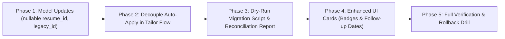

# Stage C.3 — Application Tracking Integration Readiness Report

**Date:** 2026-10-19  
**Role:** Backend / Data Auditor for JobHunt + Resume Matcher Integration  
**Mode:** Read-only audit and design gate. No database modified, no migration code executed, and no application records altered.

---

## 1. Executive Summary and Readiness Decision

This readiness report concludes Stage C.3: the backend and data audit of application tracking between JobHunt and Resume Matcher.

### Readiness Verdict
**The architectural design and data mapping are COMPLETE. The system is NOT READY for production data cutover or automated migration execution.**

Before executing any live or dry-run migration script:
1. The target schema changes (making `applications.resume_id` nullable, adding `legacy_application_id` and `follow_up_date`, and creating `application_events`) must be formally reviewed and implemented in Resume Matcher models.
2. Resume Matcher's automated status transition to `applied` upon tailoring confirmation (`/improve/confirm`) must be decoupled to respect user-confirmed submissions.
3. The persistent baseline limitations from Stage B.1 / C.2 (unverified frontend TypeScript check, Playwright / PDF test environment) must be triaged.

---

## 2. Preflight and Environment Baseline

### 2.1 Observed Now vs Carried Over from Earlier Reports

| Check | Observed Now (Stage C.3) | Carried Over from Earlier Reports | Status |
|---|---|---|---|
| **JobHunt Git Status** | `master`, untracked app/docs/tests files present, working tree untouched | `master` with untracked `.opencode/`, `app/`, `docs/`, `files.zip` | Stable |
| **Integration Git Status** | `integration/resume-matcher-foundation`, docs added | Branch created in Stage B.2; docs added in Stage C.1/C.2 | Active |
| **Resume Matcher Git Status** | `deployment-hardening`, modified app/routers/frontend files | Modified in Stage C.1 & C.2 with uncommitted discovery files | In progress |
| **Snapshot SHA-256** | `1541e113ea6a3fcf2f5c30aee008d715f281aea62984168aa74c08d45d2bfd7b` | Matches historical value `1541e113...` *(historical, not guaranteed)* | Verified Identical |
| **JobHunt Live DB SHA-256** | `56d7b8620bfe12133d749cf6219cc508d746c3d2ae458ccc9a9c6d222d23b3f0` | Matches pre-pilot value `56d7b862...` | Verified Unchanged |
| **Local Port 8013** | Listening on `127.0.0.1:8013` (FastAPI backend, PID 18132) | Running since Stage C.1 pilot | Active |
| **Local Port 3013** | Listening on `127.0.0.1:3013` (Next.js frontend, PID 23528) | Running since Stage C.1 pilot | Active |

---

## 3. Confirmed Architecture and Findings

### 3.1 JobHunt Application Tracking Subsystem
- **Core Table:** `applications(job_key PRIMARY KEY REFERENCES jobs(key), status TEXT NOT NULL, notes TEXT DEFAULT '', follow_up TEXT, updated_at TEXT NOT NULL)`.
- **Status Vocabulary (13 Statuses):** `investigating`, `shortlisted`, `drafting`, `ready_for_review`, `applied`, `assessment`, `interview`, `offer`, `hired`, `rejected`, `withdrawn`, `no_response`, `offer_declined`.
- **Confirmation Enforcement:** 6 external real-world statuses (`applied`, `assessment`, `interview`, `offer`, `hired`, `offer_declined`) require `confirmed=True` via `app/server.py`; unconfirmed calls return **HTTP 409 Conflict**.
- **Follow-up Dates:** Stored as `YYYY-MM-DD` strings; filtered via `overdue` ($< \text{today}$), `upcoming` ($\text{today} \dots \text{today} + 7\text{d}$), and `none`.
- **Status History:** No dedicated `application_history` table exists; status transitions are written to `events(ts, kind='status', job_key, detail)`.
- **Current Data in Snapshot:** Exactly **2 applications** (both in `investigating` status), **6 events**, **244 jobs**, and **0 description snapshots**.

### 3.2 Resume Matcher Application Tracking Subsystem
- **Core Model:** `Application` in `apps/backend/app/models.py`.
- **Primary Key & Uniqueness:** `application_id` (UUID PK), `UniqueConstraint("job_id", "resume_id")`.
- **Status Vocabulary (7 Columns):** `saved`, `applied`, `no_response`, `response`, `interview`, `accepted`, `rejected`. Unknown statuses are skipped from board rendering.
- **Card Positioning:** Managed via `position` integer (0..N-1) renumbered server-side upon status transitions.
- **Timestamps:** Automatic assignment of `applied_at = now()` whenever a card moves out of `saved`.
- **Auto-Apply Behavior:** Tailoring confirmation automatically inserts an `applied` card into `applications`.

---

## 4. Field Mapping and Ownership Model

- **Ownership:** Implemented as a **single-user local workstation model** on loopback (`127.0.0.1`).
- **Identity Preservation:** Preserved via an additive `legacy_application_id` column storing JobHunt's canonical `job_key`.
- **No Email Merging:** No heuristic email or domain merging is performed.
- **Discovery Isolation:** Browsing listings at `/discover/jobs` remains stateless and never mutates application records.
- **Secure Handoff:** Job descriptions and metadata must pass through backend records (`/api/v1/tailor/initiate`), never via URL query parameters. Provenance metadata (`source-provided`, `retrieved`, `pasted`) is tracked.

---

## 5. Unresolved Architectural Decisions

1. **Nullable `resume_id` in Resume Matcher:**  
   *Problem:* Resume Matcher's `applications.resume_id` is currently non-null. JobHunt applications represent early leads without tailored resumes.  
   *Decision Required:* Approve making `resume_id` nullable in SQLAlchemy models, or adopt a secondary extension table. *(Recommendation: Make `resume_id` nullable).*
2. **Kanban Status Granularity (7 vs 13 Statuses):**  
   *Problem:* Collapsing 13 statuses into 7 columns causes semantic compression (e.g. `investigating`, `shortlisted`, and `drafting` all map to `saved`).  
   *Decision Required:* Retain the 7-column board with visual badge annotations (`legacy_status`), or expand the Kanban board schema to 10+ columns. *(Recommendation: Retain 7 columns with visual badges for Stage C).*
3. **Decoupling Tailoring from Auto-Apply:**  
   *Problem:* Resume Matcher's `/improve/confirm` auto-applies cards. JobHunt requires verified user confirmation.  
   *Decision Required:* Modify `/improve/confirm` to set status to `saved` (or `drafting`), requiring explicit confirmation to advance to `applied`. *(Recommendation: Decouple immediately).*

---

## 6. Recommended Implementation Sequence for Stage C.4

1. **Phase 1: Schema Updates in Resume Matcher**  
   Update `apps/backend/app/models.py` and `database.py`: make `resume_id` nullable, add `legacy_application_id`, `legacy_status`, and `follow_up_date` columns, and create `application_events`.
2. **Phase 2: Tailoring Pipeline Decoupling**  
   Update `/improve/confirm` so that confirming a tailored resume creates a card in `saved` instead of `applied`.
3. **Phase 3: Dry-Run Migration Script**  
   Develop `scripts/migrate_jobhunt_applications.py` running exclusively between disposable copies, generating a `migration_reconciliation_report.json`.
4. **Phase 4: Frontend UI Enhancements**  
   Update `application-card.tsx` to render `[JOBHUNT]` provenance badges, `legacy_status` tags, and overdue follow-up indicators.
5. **Phase 5: Verification and Cutover Gate**  
   Execute rollback drill and source hash verification before authorizing live data migration.

---

## 7. Required Test Suite for Next Phase

1. **Unit Tests (Backend):**
   - Migration script idempotent re-run against populated DB.
   - Status translation matrix mapping for all 13 JobHunt statuses.
   - Rejection of orphan applications (missing `job_key`).
   - Nullable `resume_id` handling in `database.py` and routers.
2. **Integration Tests (API):**
   - `GET /api/v1/applications` returns cards with `legacy_application_id` and `follow_up_date`.
   - `PATCH /api/v1/applications/{id}` updating follow-up dates and notes.
   - `/improve/confirm` confirms creation of `saved` card (not `applied`).
3. **Frontend Tests (Vitest):**
   - `application-card.test.tsx`: Renders legacy status badge (e.g. `[SHORTLISTED]`).
   - `application-card.test.tsx`: Renders Swiss red warning badge on overdue follow-up.
   - `manage-columns-dialog.test.tsx`: Confirms 7 columns remain stable.

---

## 8. Exact Files Created and Integrity Confirmation

### 8.1 Documentation Created in `D:\AI-Job\ai-job-search-integration\docs\integration\`
1. `stage-c3-application-tracking-audit.md` (Detailed architectural audit of both systems)
2. `stage-c3-data-mapping.md` (Field-by-field transforms, status matrix, and handoff rules)
3. `stage-c3-migration-plan.md` (Transactional migration, reconciliation, and rollback plan)
4. `stage-c3-ui-plan.md` (Swiss design alignment, 7-column board, and handoff UI)
5. `stage-c3-readiness-report.md` (This summary and readiness gate)

### 8.2 Database and Source Integrity Confirmation
- **JobHunt Snapshot** (`D:\AI-Job\stage-c-pilot\jobhunt_snapshot.sqlite`):
  - SHA-256 Before: `1541e113ea6a3fcf2f5c30aee008d715f281aea62984168aa74c08d45d2bfd7b`
  - SHA-256 After:  `1541e113ea6a3fcf2f5c30aee008d715f281aea62984168aa74c08d45d2bfd7b`
  - Result: **100% UNCHANGED**
- **JobHunt Live DB** (`D:\AI-Job\ai-job-search\app\data\jobhunt.db`):
  - SHA-256 Before: `56d7b8620bfe12133d749cf6219cc508d746c3d2ae458ccc9a9c6d222d23b3f0`
  - SHA-256 After:  `56d7b8620bfe12133d749cf6219cc508d746c3d2ae458ccc9a9c6d222d23b3f0`
  - Result: **100% UNCHANGED**
- **No Database Writes:** Zero SQLite write connections were opened. No application records were modified.

