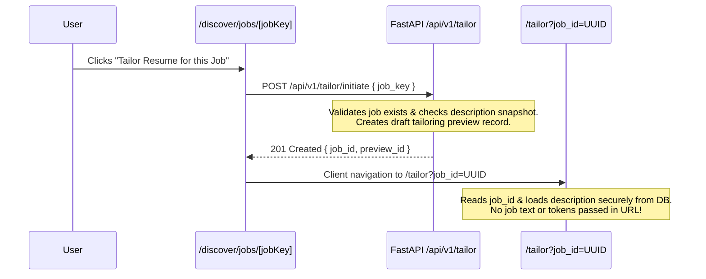

# Stage C.3 — Application Tracker UI Integration Plan

**Date:** 2026-10-19  
**Role:** Backend / Data Auditor for JobHunt + Resume Matcher Integration  
**Mode:** UI Design and Behavioral Specification. Fits Resume Matcher's existing Swiss design system.

---

## 1. Design System Alignment and Swiss Style Rules

The unified Application Tracker integrates seamlessly into Resume Matcher’s frontend (`apps/frontend/`) using its established Swiss International design system:

- **Component Hierarchy:** Anchored in `components/ui/page-frame.tsx` (`width="wide"`, `height="screen"`).
- **Typography:** Stark sans-serif headings paired with strict JetBrains Mono (`font-mono`) uppercase labels, category badges, and numerical metrics.
- **Color Palette:**
  - Canvas: `bg-canvas` (`#FFFFFF` in light mode, `#0B0C0E` in dark mode).
  - Borders: Strict 1px borders using `border-ink-soft` or `border-ink-faint`.
  
  - Text: High contrast `text-ink` for titles, `text-ink-soft` for secondary labels and timestamps.
  - Accent / Status: Restrained functional accents (e.g., Swiss red `#E24A33` for overdue dates or destructive actions; subtle ink badges for state tags).
- **No Decorative Skeuomorphism:** Flat borders, square corners (`rounded-none` or subtle `rounded-sm`), zero heavy drop shadows, clear structural grid layouts.

---

## 2. Current-State Kanban Board Design (7 Columns Only)

In strict compliance with current source constraints, the unified board renders **only the seven existing columns** defined in `APPLICATION_STATUS_ORDER`:

$$\text{Board Columns} = [\,\text{Saved},\, \text{Applied},\, \text{No Response},\, \text{Response},\, \text{Interview},\, \text{Accepted},\, \text{Rejected}\,]$$

### 2.1 Mapping JobHunt Records onto the 7 Existing Columns
Migrated JobHunt applications are rendered in the existing columns according to the mapped `status`, but carry an explicit visual badge reflecting their original granular `legacy_status`:

| Column | JobHunt Statuses Rendered Here | Visual Tag / Badge Displayed on Card |
|---|---|---|
| **Saved** | `investigating`<br>`shortlisted`<br>`drafting`<br>`ready_for_review` | `[INVESTIGATING]` (muted mono badge)<br>`[SHORTLISTED]` (ink mono badge)<br>`[DRAFTING]` (amber accent badge)<br>`[READY FOR REVIEW]` (blue accent badge) |
| **Applied** | `applied` | *(Standard applied card)* |
| **Response** | `assessment` | `[ASSESSMENT / TEST]` (purple accent badge) |
| **Interview** | `interview` | *(Standard interview card)* |
| **Accepted** | `offer`<br>`hired` | `[OFFER EXTENDED]` (emerald accent badge)<br>`[HIRED / ACCEPTED]` (solid green badge) |
| **Rejected** | `rejected`<br>`withdrawn`<br>`offer_declined` | `[REJECTED]`<br>`[WITHDRAWN BY APPLICANT]`<br>`[OFFER DECLINED]` |
| **No Response** | `no_response` | *(Standard no response card)* |

> [!NOTE]
> **Preserving User Intent:** By displaying the original `legacy_status` badge directly on the card face within the `Saved` column, users immediately distinguish between passive job bookmarks, curated shortlists, and active CV drafting without requiring schema alterations to the Kanban columns.

---

## 3. Strict Separation of Job Discovery and Application State

### 3.1 Non-Interference Invariants
1. **Browsing is Stateless:** Navigating listings at `/discover/jobs` or viewing details at `/discover/jobs/[jobKey]` never creates an application row or modifies existing status.
2. **Bookmarking is Explicit:** Clicking "Save to Tracker" creates an application card with status `saved` (and sub-status `shortlisted`).
3. **Tailoring is Non-Applying:** Clicking "Tailor Resume" generates a draft tailoring preview or document version, but **must never set the status to `applied`**. The application remains in `saved` (sub-status `drafting`).
4. **Submission Requires Explicit Confirmation:** Advancing any card to `applied` requires a conscious, verified user action.

### 3.2 The "Confirm Submission" Modal Guard
When a user moves a card to `applied` (either via drag-and-drop or status dropdown):
- A Swiss-style modal intercepts the transition:
  ```
  ┌────────────────────────────────────────────────────────┐
  │ RECORD APPLICATION SUBMISSION                          │
  │                                                        │
  │ Confirm that you have externally submitted your        │
  │ application for Staff Backend Engineer at Acme Corp.   │
  │                                                        │
  │ This records a real-world submission and advances your │
  │ tracking pipeline.                                     │
  │                                                        │
  │ Submission Date: [ 2026-10-19 ]                        │
  │ Applied Resume:  [ Resume_v2_StaffBackend.pdf ]        │
  │                                                        │
  │ [ Cancel ]                       [ Confirm Submission ]│
  └────────────────────────────────────────────────────────┘
  ```
- Submitting without confirmation is blocked with an explicit warning.

---

## 4. Enhanced Kanban Card and Detail Modal Specifications

### 4.1 Card Component (`application-card.tsx`)
The card renders in the Kanban column with the following structured layout:
1. **Header Row:**
   - Source Indicator: Mono label `[JOBHUNT]` or `[MATCHER]`.
   - Granular Status Badge: `legacy_status` badge (if originating from JobHunt).
2. **Title & Company:**
   - Role title: bold sans-serif.
   - Company name: `text-ink-soft`.
3. **Follow-up Indicator:**
   - If `follow_up_date` is present:
     - If overdue (`follow_up_date < today`): rendered in Swiss red badge `[OVERDUE: YYYY-MM-DD]`.
     - If upcoming (`follow_up_date <= today + 7d`): rendered in muted ink badge `[DUE: YYYY-MM-DD]`.
4. **Footer:**
   - Outbound link: "View Posting" (safe outbound link with `target="_blank"` and `rel="noopener noreferrer"`).
   - Tailored Resume indicator: pill linking to attached resume if present, or "No Resume Attached".

### 4.2 Detail Modal (`card-detail-modal.tsx`)
Opening a card opens a full Swiss modal featuring:
1. **Overview Section:** Company, role, applied date, location, original job URL.
2. **Follow-up Date Picker:** Input field (`type="date"`) allowing the user to schedule or clear a follow-up reminder.
3. **Notes Area:** Auto-resizing text area for recruiter notes, call logs, and next steps.
4. **Job Description Tab:**
   - Embedded complete text of the job description.
   - Provenance tag banner: `"Provenance: Manual User Paste · SHA-256: 4f8a9e... · Verified: No"`.
5. **Event History Timeline:**
   - Chronological list of events from `application_events`:
     `2026-10-18 20:44 · status · application status -> investigating`

---

## 5. Job-to-Tailoring UI Handoff Specification



### 5.1 Route and State Passing Guidelines
- **Forbidden:** Never pass description text in query parameters (`/tailor?description=...` is banned).
- **Authorized Protocol:**
  1. The user clicks "Tailor Resume" on a discovered job card.
  2. The frontend triggers `POST /api/v1/tailor/initiate` passing `{ "job_key": jobKey }`.
  3. If the job description is missing, the UI prompts the user to paste the job description first via the manual paste dialog.
  4. The backend stores the validated job and description, generating a target `job_id`.
  5. The router navigates to `/tailor?job_id=${job_id}`.
  6. The Tailoring interface loads the job text and metadata from `/api/v1/jobs/${job_id}`.

---

## 6. Proposed Future Status Taxonomy Additions (Separately Evaluated)

The following additions are proposed for a future phase to expand the Kanban board from 7 to 10 or 12 columns, pending design review:

### Proposed Additional Columns
1. **`shortlisted` Column:** Sits between `saved` and `applied`. Separates general bookmarks from actively targeted roles.
2. **`drafting` Column:** Explicit stage for applications where tailoring is currently underway.
3. **`assessment` Column:** Dedicated column for coding tests, take-home exercises, and screening assignments.
4. **`offer` Column:** Distinct from `accepted`, representing roles where an offer has been extended but negotiation is ongoing.

*Note: In this Stage C.3 plan, these columns are strictly prospective. Current implementation designs use the 7 standard columns.*

